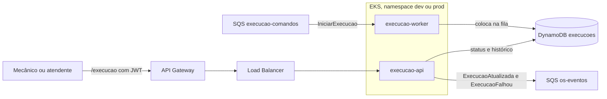

# fiap_tech_challenge_oficina_execution_service (Execution Service)

Microsserviço de execução das ordens de serviço da oficina. Mantém a fila de OS pagas, registra o diagnóstico e o reparo feitos pelo mecânico e avisa o OS Service a cada mudança, incluindo a finalização e as falhas. Faz parte do Tech Challenge Fase 4:

| Repositório | Responsabilidade |
|---|---|
| [fiap_tech_challenge_oficina_api](https://github.com/gabrielov2003/fiap_tech_challenge_oficina_api) | OS Service, orquestrador da Saga |
| [fiap_tech_challenge_oficina_billing_service](https://github.com/gabrielov2003/fiap_tech_challenge_oficina_billing_service) | Orçamentos e pagamentos com Mercado Pago |
| fiap_tech_challenge_oficina_execution_service | Este repositório. Fila de execução, diagnóstico e reparo |
| [fiap_tech_challenge_oficina_auth_lambda](https://github.com/gabrielov2003/fiap_tech_challenge_oficina_auth_lambda) | Autenticação por CPF e API Gateway |
| [fiap_tech_challenge_oficina_infra_k8s](https://github.com/gabrielov2003/fiap_tech_challenge_oficina_infra_k8s) | Rede, cluster EKS, registro de imagens, segredos e Datadog |
| [fiap_tech_challenge_oficina_infra_database](https://github.com/gabrielov2003/fiap_tech_challenge_oficina_infra_database) | Banco RDS PostgreSQL do OS Service |

## Tecnologias

Python 3.11, Flask, Flask-JWT-Extended, Flasgger, boto3, DynamoDB, SQS FIFO, Gunicorn, Datadog (ddtrace e DogStatsD), Docker, Kubernetes (EKS), Terraform e GitHub Actions.

## Arquitetura



Mesma estrutura hexagonal dos outros serviços: `domain.py` (execução e transições), `ports.py`, `application.py`, `infrastructure.py` (DynamoDB, SQS e Datadog), `web.py`, `worker.py` e `observabilidade.py`.

## Papel na Saga

A Saga é orquestrada pelo OS Service. Quando o pagamento é confirmado, ele envia `IniciarExecucao` e a OS entra na fila deste serviço com status Na fila. Depois, o mecânico avança o status pela API:

Na fila, Em diagnóstico, Aguardando peças (opcional), Em execução e Finalizada.

Cada mudança publica `ExecucaoAtualizada` com o novo status, e o OS Service atualiza a OS e o histórico. Se a execução não puder continuar (por exemplo, peça indisponível), `POST /execucao/ordens/{id_os}/falha` marca a execução como Falhou e publica `ExecucaoFalhou`. O OS Service então cancela a OS e pede o estorno ao Billing, que é a compensação da Saga.

O comando repetido não duplica a execução, e repetir um status já gravado só publica o evento de novo.

## Por que DynamoDB

Cada execução é um documento com a OS, os itens, o status atual e o histórico de mudanças, sempre acessado pela chave `id_os`. O histórico cresce com `list_append` e a troca de status usa escrita condicional, sem precisar de joins nem de transações entre tabelas. O DynamoDB não ocupa recursos do cluster, cobra por requisição e entra no free tier.

## Rotas e Swagger

Todas as rotas de negócio exigem token de funcionário (`POST /api/login`).

| Rota | O que faz |
|---|---|
| `GET /execucao/fila` | OS em execução, da mais antiga para a mais nova |
| `GET /execucao/ordens/{id_os}` | Itens, status e histórico da execução |
| `PUT /execucao/ordens/{id_os}/status` | Avança o status |
| `POST /execucao/ordens/{id_os}/falha` | Registra a falha e dispara a compensação |
| `GET /execucao/health` e `GET /execucao/ready` | Healthchecks públicos |

Swagger: `<URL do gateway>/execucao/apidocs/`.

## Testes e cobertura

```bash
python -m pip install -r requirements.txt -r requirements-dev.txt
python -m pytest --cov --cov-report=term-missing --cov-fail-under=80
```

Os testes usam o moto para simular DynamoDB e SQS. Cobrem a entrada na fila, o fluxo completo de status, a falha com compensação, transições inválidas, idempotência, permissões, mensagens inválidas e healthchecks. A cobertura de cada execução fica no resumo do job `test`, na aba [Actions](https://github.com/gabrielov2003/fiap_tech_challenge_oficina_execution_service/actions). Última medição: 93%.

## Execução local

Com credenciais AWS e os recursos do ambiente `dev` já criados pelo pipeline:

```bash
cp .env.example .env
python src/app.py
python src/worker.py
```

## Infraestrutura (Terraform em `terraform/`)

Tabela DynamoDB `oficina-<env>-execucoes`, fila FIFO `oficina-<env>-execucao-comandos.fifo` com DLQ, role do IAM com acesso só aos recursos do serviço e associação do Pod Identity com a ServiceAccount `execucao`. O estado fica em `execution-service/<env>.tfstate`.

## Kubernetes (`k8s/`)

`execucao-api` (Deployment, Service LoadBalancer e HPA de 1 a 3), `execucao-worker` (Deployment), ConfigMap, Secret e ServiceAccount, no namespace do ambiente.

## CI/CD

| Job | Quando roda | O que faz |
|---|---|---|
| `test` | Pull requests e pushes em `dev` e `main` | Testes com cobertura mínima de 80% |
| `quality` | Junto com o `test` | Ruff (erros e complexidade), Bandit (segurança) e `terraform validate` |
| `build` | Push em `dev` ou `main` | Build da imagem e push no ECR `oficina-execucao` |
| `deploy` | Depois do build | Terraform do serviço, manifestos no namespace do ambiente e URL publicada em `/oficina/<env>/execucao_url` |

`dev` publica em homologação e `main` em produção. Secrets: `AWS_ACCESS_KEY_ID` e `AWS_SECRET_ACCESS_KEY`. Variáveis: `TF_STATE_BUCKET` e, opcional, `AWS_REGION`.

---
Este projeto faz parte do Tech Challenge da Pós Graduação em Arquitetura de Software da FIAP.
